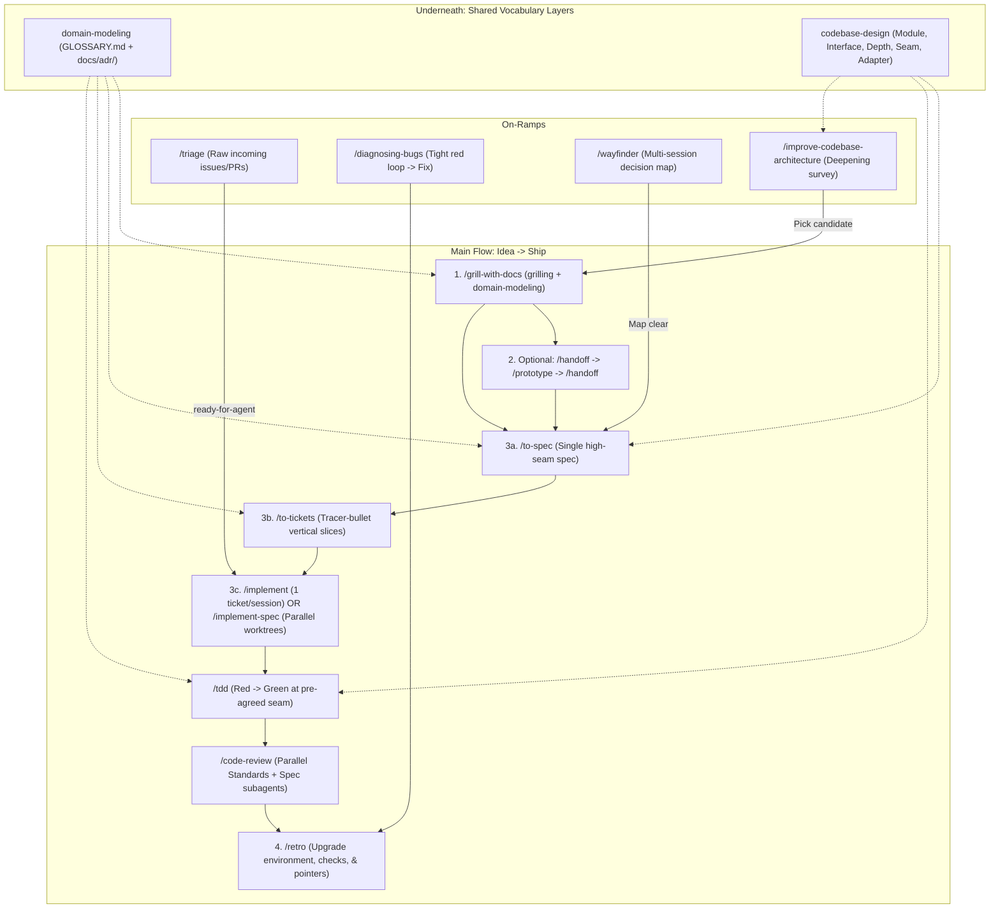

# AI-Assisted Software Engineering Workflows and Documentation Audit

> **Scope:** Primary-source investigation into (1) Matt Pocock's skill system (`/home/kabnpy/.gemini/config/skills/`), (2) complementary AI-engineering disciplines and how they map onto this repository's harness, and (3) a line-by-line audit of `docs/*.md` (10 files, 4,011 lines), `AGENTS.md`, `GEMINI.md`, and `GLOSSARY.md` against `writing-for-agents` and `domain-modeling`.

---

## 1. How to Best Use Matt Pocock's Skills to Build Software

Matt Pocock's skills form a deliberate, state-aware engineering system organized around **one main flow**, **three on-ramps**, **two always-available vocabulary layers**, **explicit phase boundaries**, and **an environment feedback loop** ([`ask-matt/SKILL.md`](file:///home/kabnpy/.gemini/config/skills/ask-matt/SKILL.md)).

### 1.1 Architecture of the Skill System: Model-Invoked vs. User-Invoked

In [`writing-for-agents/SKILL-MECHANICS.md`](file:///home/kabnpy/.gemini/config/skills/writing-for-agents/SKILL-MECHANICS.md), skills trade off two distinct budgets defined in [`writing-for-agents/SKILL.md`](file:///home/kabnpy/.gemini/config/skills/writing-for-agents/SKILL.md#L20-L27):
- **Context load:** The per-turn token and attention cost of material sitting in the agent's window every turn (`AGENTS.md` lines, model-invoked skill descriptions).
- **Cognitive load:** The cost on the human to remember which workflows exist and when to invoke them.

Accordingly, the skills split into two invocation classes:
1. **User-invoked flow controllers (`disable-model-invocation: true`):** `/ask-matt` (the router skill that cures human cognitive load), `/grill-with-docs`, `/grill-me`, `/wayfinder`, `/to-spec`, `/to-tickets`, `/implement`, `/implement-spec`, `/improve-codebase-architecture`, `/triage`, `/handoff`, and `/retro`. Because they strip trigger descriptions from automatic model discovery, they cost **zero permanent context load**.
2. **Model-invoked reference and execution primitives (always-loaded descriptions):** `writing-for-agents`, `codebase-design`, `domain-modeling`, `grilling`, `tdd`, `code-review`, `diagnosing-bugs`, `prototype`, `research`, `pr`, `wizard`, and `ticket-learning-workflow`. These stay discoverable so either the human or another skill can pull them in on demand.

### 1.2 The Main Flow: Idea to Ship

Per [`ask-matt/SKILL.md`](file:///home/kabnpy/.gemini/config/skills/ask-matt/SKILL.md#L15-L41), feature work runs through four sequential stages with strict context-window rules:

#### Stage 1: Relentless Interview + Live Domain Modeling (`/grill-with-docs`)
- **Mechanics:** [`grill-with-docs/SKILL.md`](file:///home/kabnpy/.gemini/config/skills/grill-with-docs/SKILL.md) invokes two primitives simultaneously: [`grilling/SKILL.md`](file:///home/kabnpy/.gemini/config/skills/grilling/SKILL.md) and [`domain-modeling/SKILL.md`](file:///home/kabnpy/.gemini/config/skills/domain-modeling/SKILL.md).
- **The Design Tree & Frontier (`grilling`):** The agent maps the idea as a **design tree** of dependent decisions and asks the entire **frontier** (every decision whose prerequisites are settled) in numbered rounds, supplying a recommended default for each question so `"yes"` accepts it ([`grilling/SKILL.md`](file:///home/kabnpy/.gemini/config/skills/grilling/SKILL.md#L6-L26)). Crucially: *"Finding facts is your job, never the user's"*—if a question depends on codebase state, the agent dispatches a fresh-context subagent to look it up rather than asking the user ([`grilling/SKILL.md`](file:///home/kabnpy/.gemini/config/skills/grilling/SKILL.md#L28)).
- **Inline Paper Trail (`domain-modeling`):** Unlike stateless `/grill-me` (used only when no repository exists), `/grill-with-docs` challenges vague or conflicting terms against [`GLOSSARY.md`](file:///home/kabnpy/Projects/healthwatch-ms/GLOSSARY.md), stress-tests domain relationships with concrete edge-case scenarios, cross-references claims against code, and updates `GLOSSARY.md` inline the moment a term crystallizes ([`domain-modeling/SKILL.md`](file:///home/kabnpy/.gemini/config/skills/domain-modeling/SKILL.md#L44-L64)).
- **Three-Gate ADR Filter:** `domain-modeling` records an ADR in `docs/adr/NNNN-slug.md` **only** when all three conditions hold: (1) **hard to reverse**, (2) **surprising without context**, and (3) **the result of a real trade-off** ([`domain-modeling/ADR-FORMAT.md`](file:///home/kabnpy/.gemini/config/skills/domain-modeling/ADR-FORMAT.md#L29-L37)).

#### Stage 2: Throwaway Prototype Detour (`/handoff` -> `/prototype` -> `/handoff`)
- When a question cannot be settled in prose—either *"Does this logic/state model feel right?"* ([`prototype/LOGIC.md`](file:///home/kabnpy/.gemini/config/skills/prototype/LOGIC.md)) or *"What should this UI look like?"* ([`prototype/UI.md`](file:///home/kabnpy/.gemini/config/skills/prototype/UI.md))—fork out via [`handoff/SKILL.md`](file:///home/kabnpy/.gemini/config/skills/handoff/SKILL.md), build in-memory throwaway code with zero polish, capture the prototype on a unmerged `prototype/<name>` branch as a primary source, and hand the verdict back into the main thread ([`prototype/SKILL.md`](file:///home/kabnpy/.gemini/config/skills/prototype/SKILL.md#L19-L26)).

#### Stage 3: Specification and Vertical Slicing (`/to-spec` -> `/to-tickets`)
- **Keep Steps 1–3 in One Unbroken Context Window:** [`ask-matt/SKILL.md`](file:///home/kabnpy/.gemini/config/skills/ask-matt/SKILL.md#L38-L40) mandates keeping `/grill-with-docs` -> `/to-spec` -> `/to-tickets` in the **same session** (without clearing or compacting unless approaching the ~150k-token **smart zone**) so that `/to-spec` and `/to-tickets` consume the interview as a **primary source** rather than a lossy summary ([`ask-matt/PHASE-BOUNDARIES.md`](file:///home/kabnpy/.gemini/config/skills/ask-matt/PHASE-BOUNDARIES.md#L42-L51)).
- **Synthesize Spec Without Re-Interviewing (`/to-spec`):** [`to-spec/SKILL.md`](file:///home/kabnpy/.gemini/config/skills/to-spec/SKILL.md) synthesizes the conversation using `GLOSSARY.md` terms, sketches the **highest possible testing seam** (preferring existing seams, ideally one seam), confirms that seam with the user, and publishes a GitHub issue labeled `ready-for-agent`. Crucially, specs **exclude file paths and code snippets** (which go stale rapidly), except minimal state-machine/schema snippets extracted from a prototype ([`to-spec/SKILL.md`](file:///home/kabnpy/.gemini/config/skills/to-spec/SKILL.md#L55-L57)).
- **Tracer-Bullet Vertical Slices (`/to-tickets`):** [`to-tickets/SKILL.md`](file:///home/kabnpy/.gemini/config/skills/to-tickets/SKILL.md#L27-L40) breaks a spec into narrow, end-to-end slices cutting through every layer (schema, API, UI, tests), each demoable on its own and sized to one fresh context window, wired with native GitHub blocking edges (`gh issue create --parent <spec> --blocked-by <id>` per [`docs/agents/issue-tracker.md`](file:///home/kabnpy/Projects/healthwatch-ms/docs/agents/issue-tracker.md#L10-L11)).
  - *Exception for Wide Refactors:* When a mechanical change has a codebase-wide blast radius, `/to-tickets` forbids forcing a vertical slice and instead sequences **expand -> batched migrate -> contract** ([`to-tickets/SKILL.md`](file:///home/kabnpy/.gemini/config/skills/to-tickets/SKILL.md#L40)).

#### Stage 4: Implementation, TDD, Two-Axis Review, and Retrospective
Once tickets exist on the tracker, **clear the planning context** (`/clear`). Implementation has three execution modes depending on human involvement:

| Execution Skill | When to Use | Context & Worktree Model | Quality Gate |
| :--- | :--- | :--- | :--- |
| **`/implement`** ([`SKILL.md`](file:///home/kabnpy/.gemini/config/skills/implement/SKILL.md)) | Single ticket or small single-session feature driven by the developer. | One ticket per fresh context window (`/clear` between tickets). | Runs `/tdd` at pre-agreed seams -> typecheck/test -> runs `/code-review` -> commits. |
| **`/implement-spec`** ([`SKILL.md`](file:///home/kabnpy/.gemini/config/skills/implement-spec/SKILL.md)) | Full multi-ticket spec orchestrated autonomously across the DAG frontier. | Spawns an optional exploration subagent, then parallel **implementer subagents** (each in its own worktree off an integration branch) + **merger subagent**. Sparse communication via context pointers. | Each implementer runs `/tdd`; one final `/code-review` runs across the integration branch. |
| **`ticket-learning-workflow`** ([`SKILL.md`](file:///home/kabnpy/.gemini/config/skills/ticket-learning-workflow/SKILL.md)) | Collaborative/educational implementation where the developer wants to retain ownership or learn unfamiliar parts. | Single ticket at a time; adaptive division of labor (*User-led*, *Demonstration*, *Pairing*, *Agent-led with explanation*). | Preserves `/implement`, `/tdd`, and `/code-review` gates while adding a learning checkpoint and explicit acceptance verification. |

- **Discipline Inside `/tdd` ([`tdd/SKILL.md`](file:///home/kabnpy/.gemini/config/skills/tdd/SKILL.md)):**
  1. **Test only at pre-agreed seams:** Write down the public interface seams (noting what each catches and misses) and confirm with the user before writing any test ([`tdd/SKILL.md`](file:///home/kabnpy/.gemini/config/skills/tdd/SKILL.md#L22-L24)).
  2. **Avoid the three test anti-patterns:** (a) *Implementation-coupled* (mocking internal collaborators or querying the DB behind the interface; see [`tdd/tests.md`](file:///home/kabnpy/.gemini/config/skills/tdd/tests.md) and [`tdd/mocking.md`](file:///home/kabnpy/.gemini/config/skills/tdd/mocking.md)), (b) *Tautological* (recomputing expected values using the same formula as production code rather than asserting known-good independent literals), and (c) *Horizontal slicing* (writing all tests upfront before any implementation).
  3. **Refactoring is separated from the Red-Green loop:** In Matt Pocock's agent workflow, refactoring belongs to the review stage (`/code-review`), keeping each red-green cycle minimal ([`tdd/SKILL.md`](file:///home/kabnpy/.gemini/config/skills/tdd/SKILL.md#L38)).
- **Two-Axis Parallel Review (`/code-review`):** [`code-review/SKILL.md`](file:///home/kabnpy/.gemini/config/skills/code-review/SKILL.md) pins the merge-base (`git diff <fixed-point>...HEAD`) and spawns **two parallel fresh-context subagents**:
  1. **Standards Subagent:** Checks the diff against documented repo standards (`GEMINI.md`, `CODING_STANDARDS.md`) plus Fowler's 12 code smells (Mysterious Name, Duplicated Code, Feature Envy, Data Clumps, Primitive Obsession, Repeated Switches, Shotgun Surgery, Divergent Change, Speculative Generality, Message Chains, Middle Man, Refused Bequest), skipping anything linters enforce.
  2. **Spec Subagent:** Checks the diff against the originating GitHub issue/spec for missing requirements, scope creep, or wrong implementations.
  - Keeping the axes separate prevents a clean-code diff that built the wrong feature (or a spec-complete diff that violated architectural invariants) from masking the failure ([`code-review/SKILL.md`](file:///home/kabnpy/.gemini/config/skills/code-review/SKILL.md#L82-L89)).
- **Closing the Loop (`/retro`):** [`retro/SKILL.md`](file:///home/kabnpy/.gemini/config/skills/retro/SKILL.md) inspects the session transcript to upgrade the **agent's environment**, not the application code. Crucially, [`retro/SKILL.md`](file:///home/kabnpy/.gemini/config/skills/retro/SKILL.md#L29-L36) distinguishes **Implementation** (high context pressure: exploration, coding, debugging) from **Review** (low context pressure: inspecting a bounded diff). Therefore:
  - **Mechanical mistakes** (banned APIs, float usage, import rules) must become **deterministic automated checks** (linters, pre-commit hooks, CI jobs).
  - **Judgement calls** belong in review standards (`CODING_STANDARDS.md` / review skills), not bloated into `AGENTS.md`.

### 1.3 On-Ramps for Non-Feature Work
- **Large, Foggy Initiatives (`/wayfinder`):** When an effort is too large to hold in one session and the route to the destination is obscured by **fog of war**, [`wayfinder/SKILL.md`](file:///home/kabnpy/.gemini/config/skills/wayfinder/SKILL.md) creates a single `wayfinder:map` GitHub issue and resolves child **decision tickets** (`wayfinder:research`, `wayfinder:prototype`, `wayfinder:grilling`, `wayfinder:task`) one per session. It produces *decisions, not deliverables*, and hands off to `/to-spec` once the map clears ([`wayfinder/SKILL.md`](file:///home/kabnpy/.gemini/config/skills/wayfinder/SKILL.md#L11-L13)).
- **Hard Bugs & Regressions (`/diagnosing-bugs`):** [`diagnosing-bugs/SKILL.md`](file:///home/kabnpy/.gemini/config/skills/diagnosing-bugs/SKILL.md) forbids reading code to form theories until **Phase 1** has produced a **tight, red-capable feedback loop** (one fast, deterministic, agent-runnable command that already reproduces the exact symptom). It then mandates **Phase 2 (Minimise to load-bearing elements)** -> **Phase 3 (3–5 ranked falsifiable hypotheses)** -> **Phase 4 (Tagged `[DEBUG-xxxx]` probes)** -> **Phase 5 (Regression test at the right seam before fix; if no deep seam exists, flag for `/improve-codebase-architecture`)** -> **Phase 6 (Cleanup)**.
- **Codebase Upkeep (`/improve-codebase-architecture` + `codebase-design`):** Scans git hotspots for shallow modules, applies the **deletion test**, renders a visual HTML before/after report in `/tmp`, and uses **Design It Twice** ([`codebase-design/DESIGN-IT-TWICE.md`](file:///home/kabnpy/.gemini/config/skills/codebase-design/DESIGN-IT-TWICE.md))—spawning 3+ parallel subagents with competing interface constraints (minimize entry points vs. maximize flexibility vs. optimize common caller)—to design deep modules.

---

## 2. Complementary & Advanced Methods in AI-Assisted Software Engineering

While Matt Pocock's skills excel at conversational problem framing, vertical slicing, and context hygiene, high-assurance financial domains like HealthWatch MS benefit from five complementary AI-engineering practices that tighten and extend the skill system.

### 2.1 Harness & Environment Engineering (Mechanical Guardrails Over Prompt Prose)
- **Principle:** [`writing-for-agents/SKILL.md`](file:///home/kabnpy/.gemini/config/skills/writing-for-agents/SKILL.md#L74-L81) notes that steering via prohibition (*"Don't use float"*, *"Never edit on main"*) suffers from the **negation trap** (activating the forbidden token in context) and spends permanent context load every turn. [`retro/SKILL.md`](file:///home/kabnpy/.gemini/config/skills/retro/SKILL.md#L19) states: *"A mechanical violation gets a deterministic check, full stop... Default to building the check over writing the rule."*
- **How HealthWatch MS Implements & Can Extend This:**
  - The repo already includes [`.agents/hooks.json`](file:///home/kabnpy/Projects/healthwatch-ms/.agents/hooks.json) (`git-guard` PreToolUse hook blocking edits/commits on `main`, and `commit-gate` Stop hook), unified `./run` task worktree commands (`./run task:start`, `./run task:finish`), and `prek` pre-commit hooks (`ruff`, `biome`, `scripts/check_commit_msg.py`).
  - **Gap & Opportunity:** `git-guard` in `.agents/hooks.json` is currently `"enabled": false`, which forces `GEMINI.md` to carry multiple paragraphs of git/worktree prohibitions in context every turn. Enabling `git-guard` and adding a custom AST/Ruff lint check (e.g., banning `: float` in `models.py` / `schemas.py` / `services/` and banning naive `datetime.now()`) converts `GEMINI.md` prose into zero-token deterministic gates.

### 2.2 Deep Modules vs. Shallow Pass-Throughs (`codebase-design` Applied to FastAPI + React)
- **Principle:** John Ousterhout's *A Philosophy of Software Design*, adapted in [`codebase-design/SKILL.md`](file:///home/kabnpy/.gemini/config/skills/codebase-design/SKILL.md) and [`codebase-design/DEEPENING.md`](file:///home/kabnpy/.gemini/config/skills/codebase-design/DEEPENING.md), defines **depth** as **leverage at the interface**: how much domain behavior callers and tests exercise per unit of interface they must learn.
- **Mapping to HealthWatch MS:**
  - In [`codebase-design/DEEPENING.md`](file:///home/kabnpy/.gemini/config/skills/codebase-design/DEEPENING.md#L5-L26), dependencies fall into four categories: (1) *In-process* (`RatingService` pure `Decimal` math), (2) *Local-substitutable* (PostgreSQL test DB in `pytest`), (3) *Remote but owned* (FastAPI HTTP boundary consumed by `@hey-api` SDK), and (4) *True external* (Cloudflare R2 behind `StorageProvider`).
  - **Where HealthWatch MS Is Deep:** `RatingService.calculate_breakdown` and `RenewalsService` hide multi-bracket rating, statutory levies (`0.20%` ITL, `0.25%` PHCF, `KES 40` Stamp Duty), and OCC version checks behind small interfaces.
  - **Where Shallow Seams Lurk:** `backend/app/models.py` (1,762 lines) currently mixes legacy models (`Receipt`, `ReceiptAllocation`, `Correspondence`, `TransactionType.CANCELLATION`, `Product.default_commission_rate: float = 10.0` at [`backend/app/models.py#L62-L93`](file:///home/kabnpy/Projects/healthwatch-ms/backend/app/models.py#L62-L93), [`backend/app/models.py#L388`](file:///home/kabnpy/Projects/healthwatch-ms/backend/app/models.py#L388), and [`backend/app/models.py#L847-L932`](file:///home/kabnpy/Projects/healthwatch-ms/backend/app/models.py#L847-L932)) alongside authoritative models (`PaymentRecord`, `PaymentAllocation`, `Activity`, `CommissionSchedule`). For an AI agent, co-existing legacy and current models in `models.py` is a high-variance trap: the agent must read documentation to know which table is live. Deleting or isolating deprecated tables is the ultimate **deletion test** ([`codebase-design/SKILL.md`](file:///home/kabnpy/.gemini/config/skills/codebase-design/SKILL.md#L63)).

### 2.3 Smart-Zone Context Budgeting & Implementation/Review Separation
- **Principle:** Frontier LLMs degrade in multi-hop reasoning and instruction following well before their nominal context limit—entering "context rot" past the ~150k-token **smart zone** ([`ask-matt/SKILL.md`](file:///home/kabnpy/.gemini/config/skills/ask-matt/SKILL.md#L40), [`ask-matt/PHASE-BOUNDARIES.md`](file:///home/kabnpy/.gemini/config/skills/ask-matt/PHASE-BOUNDARIES.md#L21)).
- **Mapping to HealthWatch MS:**
  - Compare [`AGENTS.md`](file:///home/kabnpy/Projects/healthwatch-ms/AGENTS.md) (13 lines, 3 crisp context pointers) with [`GEMINI.md`](file:///home/kabnpy/Projects/healthwatch-ms/GEMINI.md) (78 lines of mixed architectural constraints, domain definitions, CLI commands, and skill triggers) and `docs/` (4,011 lines).
  - When an agent is told in `GEMINI.md`: *"SOURCE OF TRUTH: `docs/`"*, an implementation agent under high context pressure risks reading 2,400+ lines of `insurance_agency_system_documentation.md` and `domain_deep_dive.md` into its active window—burning 40k+ tokens of smart-zone capacity on duplicated or superseded prose before writing a single line of code.
  - **Solution:** Keep `AGENTS.md` / `GEMINI.md` strictly as compact **context pointers** ([`writing-for-agents/SKILL.md`](file:///home/kabnpy/.gemini/config/skills/writing-for-agents/SKILL.md#L10-L18)), keep `GLOSSARY.md` + `docs/adr/` as the fast-loading domain baseline, and push domain invariant checklists into review-stage subagents ([`.agents/skills/domain-audit/SKILL.md`](file:///home/kabnpy/Projects/healthwatch-ms/.agents/skills/domain-audit/SKILL.md), [`.agents/skills/verify/SKILL.md`](file:///home/kabnpy/Projects/healthwatch-ms/.agents/skills/verify/SKILL.md), and `/code-review`).

### 2.4 Property-Based & Invariant Testing for Financial Domains (Extending `/tdd`)
- **Principle:** [`tdd/SKILL.md`](file:///home/kabnpy/.gemini/config/skills/tdd/SKILL.md#L31) warns against **tautological tests** where the test recomputes the expected number using the same logic as the implementation, and recommends example-based literal assertions. However, in financial systems with bracket boundaries, fixed-point rounding (`ROUND_HALF_UP`), and allocation locks, 3–5 hand-picked examples can miss boundary off-by-one bugs or rounding drift.
- **How to Extend `/tdd` for HealthWatch MS:**
  Pair example-based vertical slices in `/tdd` with **property-based invariant tests** (using `hypothesis` in Python `pytest`, which is already alluded to in [`diagnosing-bugs/SKILL.md`](file:///home/kabnpy/.gemini/config/skills/diagnosing-bugs/SKILL.md#L32) as a *"Property / fuzz loop"*):
  1. **Reconciliation Invariant:** For any generated `Decimal` sum insured, rate bracket, and benefit combination, `PremiumCalculation.total_premium == sum(rounded_line_items)` and every line item has `as_tuple().exponent >= -2`.
  2. **Bracket Partition Invariant:** Across any published `RateTableVersion`, every positive `Decimal` value in `[0, 100_000_000]` matches **at most one** `[min_value, max_value)` bracket (never two).
  3. **Ledger Allocation Conservation Invariant:** Under any sequence of allocations and reversals against a `PaymentRecord`, `unallocated_amount == amount - sum(active_allocations) >= Decimal("0.00")`.
  4. **Idempotency & Determinism Invariant:** Re-evaluating `RatingService` with the same `input_snapshot` and `RateTableVersion` produces bit-identical `Decimal` outputs.

### 2.5 Contract-First OpenAPI Seams (Bridging Backend & Frontend Slices)
- **Principle:** [`to-tickets/SKILL.md`](file:///home/kabnpy/.gemini/config/skills/to-tickets/SKILL.md#L29-L36) mandates vertical tracer-bullet slices through schema, API, UI, and tests. In a typed FastAPI -> OpenAPI -> `@hey-api/openapi-ts` -> React 19 stack, the **OpenAPI schema (`frontend/openapi.json`) is the primary cross-tier seam**.
- **Integration with Repo Skills:**
  - The repo's local skills—[`client-regen`](file:///home/kabnpy/Projects/healthwatch-ms/.agents/skills/client-regen/SKILL.md), [`db-migration`](file:///home/kabnpy/Projects/healthwatch-ms/.agents/skills/db-migration/SKILL.md), [`domain-audit`](file:///home/kabnpy/Projects/healthwatch-ms/.agents/skills/domain-audit/SKILL.md), [`qa-journey`](file:///home/kabnpy/Projects/healthwatch-ms/.agents/skills/qa-journey/SKILL.md), and [`verify`](file:///home/kabnpy/Projects/healthwatch-ms/.agents/skills/verify/SKILL.md)—provide the exact domain-specific execution gates that Matt Pocock's general `/implement`, `/tdd`, and `/code-review` skills delegate to.
  - Specifically, when running `/implement-spec` with parallel worktrees, [`docs/06_git_hygiene.md`](file:///home/kabnpy/Projects/healthwatch-ms/docs/06_git_hygiene.md#L91-L92) and [`client-regen/SKILL.md`](file:///home/kabnpy/Projects/healthwatch-ms/.agents/skills/client-regen/SKILL.md#L34-L36) enforce a critical constraint: **ports 5432/8000/5173 are shared across worktrees, and `openapi.json` / `frontend/src/client/` must only be regenerated by one task at a time** (or in the merger subagent) to prevent generated-file merge conflicts.

---

## 3. Audit of `docs/*.md`, `AGENTS.md`, `GEMINI.md`, and `GLOSSARY.md`

### 3.1 Evaluation Criteria (from `writing-for-agents` and `domain-modeling`)
1. **Single Source of Truth vs. Duplication ([`writing-for-agents/SKILL.md#L78`](file:///home/kabnpy/.gemini/config/skills/writing-for-agents/SKILL.md#L78)):** Each meaning must live in one authoritative place so changing behavior is a one-place edit.
2. **Environment as Source of Truth vs. Stale Cache ([`writing-for-agents/SKILL.md#L79`](file:///home/kabnpy/.gemini/config/skills/writing-for-agents/SKILL.md#L79)):** A document that restates `models.py`, `api/main.py`, `package.json`, or directory layout is a **cache** of a one-file lookup. Cache only what the agent cannot find by looking (unwritten conventions, the *why* behind a choice, domain rules).
3. **Sprawl & Sediment ([`writing-for-agents/SKILL.md#L43`](file:///home/kabnpy/.gemini/config/skills/writing-for-agents/SKILL.md#L43), [`#L80`](file:///home/kabnpy/.gemini/config/skills/writing-for-agents/SKILL.md#L80)):** Long documents where historical exploration settles beside live rules force agents to core through sediment to find what is still true.
4. **Clean Glossary & Lazy Atomic ADRs ([`domain-modeling/SKILL.md#L61-L74`](file:///home/kabnpy/.gemini/config/skills/domain-modeling/SKILL.md#L61-L74)):**
   - `GLOSSARY.md` at repo root must hold opinionated, 1–2 sentence domain definitions with `_Avoid_:` lists, completely devoid of implementation details ([`domain-modeling/GLOSSARY-FORMAT.md`](file:///home/kabnpy/.gemini/config/skills/domain-modeling/GLOSSARY-FORMAT.md)).
   - ADRs must live as individual numbered files in `docs/adr/0001-slug.md` (1–3 sentences per decision) rather than a single monolithic historical log, and only for decisions that are *hard to reverse*, *surprising without context*, and *real trade-offs* ([`domain-modeling/ADR-FORMAT.md`](file:///home/kabnpy/.gemini/config/skills/domain-modeling/ADR-FORMAT.md)).

### 3.2 Inventory & Diagnosis of All 10 Files in `docs/` (4,011 Lines Total)

| File | Lines | Diagnosis (`writing-for-agents` / `domain-modeling`) | Verdict |
| :--- | ---: | :--- | :--- |
| [`docs/domain_deep_dive.md`](file:///home/kabnpy/Projects/healthwatch-ms/docs/domain_deep_dive.md) | 1,197 | **Toxic Sediment & Active Contradictions.** Self-described historical v2.0 exploration (dated 2026-02-13) with a disclaimer banner at lines 9–15 warning that it is superseded. Worse, its body actively contradicts current domain invariants: claims `RiskNote` *"is NEVER given to clients (internal only)"* and *"Acts as the SINGLE SOURCE OF TRUTH for policy state"* (lines 35–36), teaches the deprecated `Receipt` / `ReceiptAllocation` / `Correspondence` / `ClaimEvent` models (lines 136–142, 526–612), and includes 400+ lines of outdated SQLModel code (`policy_snapshot`, `levies` JSON, naive `datetime.now`). | **DELETE** |
| [`docs/insurance_agency_system_documentation.md`](file:///home/kabnpy/Projects/healthwatch-ms/docs/insurance_agency_system_documentation.md) | 1,203 | **Monolithic Sprawl & Internal Drift.** Written as an initial pre-implementation baseline (*"It does not establish that any feature has already been implemented"* at line 7). Internally contradicts the implemented system and `01`–`07` docs: e.g., §4.6 (lines 167–171) defines a **7-state** renewal flow (`payment_evidence_received`, `renewal_requested`) whereas `models.py` and `01`/`03`/`04` implement the **6-state** flow (`paid`); §3 & §11.1–11.2 (lines 94–98, 813–825) state *"Python 3.12"*, *"server-side sessions in PostgreSQL"*, and *"no role-based access control"*, whereas the app runs Python 3.14, JWT bearer tokens, and 5 RBAC roles (`Admin`, `Underwriter`, `Cashier`, `Operations`, `Viewer`); §9.1 (lines 717–718) proposes `python-docx` / LibreOffice; §15 & §18.10 (lines 913–916, 1092) claim commission accounting is out of scope, whereas §4.17 and §18.15 in the *same file* specify it. Meanwhile, `01`–`04` and `07` already extracted its live sections almost verbatim. | **DELETE (after distilling unique edge rules in §4.14–4.15 & §18.9)** |
| [`docs/03_backend_data_models.md`](file:///home/kabnpy/Projects/healthwatch-ms/docs/03_backend_data_models.md) | 390 | **Stale Code Cache.** Restates [`backend/app/models.py`](file:///home/kabnpy/Projects/healthwatch-ms/backend/app/models.py) field-by-field in Markdown, but has already drifted from `models.py` across multiple tables (see §3.3 below for exact field discrepancies). Lines 106–115 and 160–165 contain valuable domain invariants on `RiskNote` triggers and rating paradigms that belong in `GLOSSARY.md` / ADRs, not buried inside a schema cache. | **DELETE (move non-schema invariants to `GLOSSARY.md` & `docs/adr/`)** |
| [`docs/architecture_decision_records.md`](file:///home/kabnpy/Projects/healthwatch-ms/docs/architecture_decision_records.md) | 289 | **Wrong Format + Superseded Sediment.** Monolithic 15-ADR register instead of `docs/adr/NNNN-slug.md` (which [`AGENTS.md`](file:///home/kabnpy/Projects/healthwatch-ms/AGENTS.md) and [`docs/agents/domain.md`](file:///home/kabnpy/Projects/healthwatch-ms/docs/agents/domain.md) point to, even though `docs/adr/` does not exist yet!). Of its 15 ADRs, 6 are `Superseded` or `Amended` (`ADR-004`, `ADR-005`, `ADR-008`, `ADR-009`, `ADR-012`), and several (`ADR-006`, `ADR-007`, `ADR-013`) are routine UI/component choices that fail the 3-gate ADR test in [`domain-modeling/ADR-FORMAT.md`](file:///home/kabnpy/.gemini/config/skills/domain-modeling/ADR-FORMAT.md#L29-L37). | **REPLACE with `docs/adr/0001..0006-*.md` & DELETE monolith** |
| [`docs/01_product_specs.md`](file:///home/kabnpy/Projects/healthwatch-ms/docs/01_product_specs.md) | 222 | **High-Value Domain Reference (with Duplication).** Section 2 ("Terminology & Usage Guide", lines 27–47) defines 16 core domain terms that belong in [`GLOSSARY.md`](file:///home/kabnpy/Projects/healthwatch-ms/GLOSSARY.md) (which currently has only 3 terms!). Sections 3.1–3.6 (New Business, Renewal state machine, 6 Rating Paradigms, IPF §156A, Commission WHT formula, Claims lifecycle) are concise and accurate, though duplicated in `insurance_agency_system_documentation.md` (§4.14–4.18) and `07_reference_catalog_and_seeding.md`. | **KEEP & PRUNE (move §2 terms to `GLOSSARY.md`; keep §1, §3, §4 as canonical product reference)** |
| [`docs/07_reference_catalog_and_seeding.md`](file:///home/kabnpy/Projects/healthwatch-ms/docs/07_reference_catalog_and_seeding.md) | 225 | **Mixed Reference + Duplication.** Sections 1.1 and 8 repeat the statutory levy rates and payment allocation invariants already in `GEMINI.md`, `01_product_specs.md`, and `GLOSSARY.md`. Sections 2–7 (the 8 Kenyan underwriters, 30 products, 28 client archetypes, KRA PIN / NTSA formats, and RBAC seed accounts) are a useful specification of the Kenyan insurance domain and acceptance fixtures, though partly cached from `backend/app/seed_mock_data.py`. | **KEEP & TRIM (remove duplicated §1.1 & §8 invariants; keep Kenyan market catalog & seed archetypes)** |
| [`docs/05_design_system.md`](file:///home/kabnpy/Projects/healthwatch-ms/docs/05_design_system.md) | 173 | **Clean, Focused Disclosed Reference.** Defines OKLCH surface tiers, semantic status badges, the `font-mono tabular-nums` financial numeral invariant, table density rules, wizard rules, and `@media print` A4 constraints. Step/branch specific to UI work. Only §1.1 (lines 22–27, "Approved Entity Terms") duplicates `GLOSSARY.md`. | **KEEP (replace §1.1 term list with pointer to `GLOSSARY.md`)** |
| [`docs/02_tech_architecture.md`](file:///home/kabnpy/Projects/healthwatch-ms/docs/02_tech_architecture.md) | 117 | **Mostly Duplicated Cache.** §1 (Tech Stack) duplicates `GEMINI.md` and `package.json`/`pyproject.toml`. §2.1–2.7 (Snapshots, Rating, OCC, Active Renewal Index, Async Jobs, Financial Precision, Bounded Ledger) duplicates `GEMINI.md` and `ADR-014`. §4 ("Canonical API Routes", lines 102–117) is a **stale cache** that disagrees with [`backend/app/api/main.py`](file:///home/kabnpy/Projects/healthwatch-ms/backend/app/api/main.py) (see §3.3 below). Only §3 (the 8-line Immutability & Deletion matrix) and §2.5 (async job state rules) add concise reference value. | **DISTILL into `docs/adr/` & `01_product_specs.md`, then DELETE** |
| [`docs/06_git_hygiene.md`](file:///home/kabnpy/Projects/healthwatch-ms/docs/06_git_hygiene.md) | 99 | **Focused Operational Runbook.** Good disclosed reference for Conventional Commits, `.worktrees/` isolation, and `.agents/hooks.json`. However, lines 19–22 of `GEMINI.md` duplicate almost the entire file inline. | **KEEP (and shrink `GEMINI.md`'s git section to a 2-line pointer here)** |
| [`docs/04_development_roadmap.md`](file:///home/kabnpy/Projects/healthwatch-ms/docs/04_development_roadmap.md) | 96 | **Completed Historical Checklist (Sediment).** Every single phase (Phase 0 through Phase 4) and every checkbox in the Production Acceptance Checklist is marked `Completed` / `[x]`. Pointed to by `GEMINI.md` line 4 (`ROADMAP & STATUS: docs/04_development_roadmap.md`), tempting agents to read 96 lines of finished history when active work now lives in GitHub Issues (`docs/agents/issue-tracker.md`). | **DELETE or ARCHIVE (remove pointer from `GEMINI.md`; track live work in GitHub Issues)** |

### 3.3 Proof of Stale Code Caches (`03_backend_data_models.md` and `02_tech_architecture.md` vs. Codebase)

Per [`writing-for-agents/SKILL.md`](file:///home/kabnpy/.gemini/config/skills/writing-for-agents/SKILL.md#L79), restating code in documentation creates a cache that inevitably drifts from the environment:

1. **`docs/03_backend_data_models.md` vs. [`backend/app/models.py`](file:///home/kabnpy/Projects/healthwatch-ms/backend/app/models.py):**
   - **`Insurer` ([`03_backend_data_models.md#L33-L42`](file:///home/kabnpy/Projects/healthwatch-ms/docs/03_backend_data_models.md#L33-L42) vs. [`models.py#L346-L374`](file:///home/kabnpy/Projects/healthwatch-ms/backend/app/models.py#L346-L374)):** Doc claims fields `code`, `contact_email`, `contact_phone`, `portal_url`, `is_active`. Actual `InsurerBase` in `models.py` has only `name`, `email`, `phone` (plus `AuditMixin`).
   - **`Client` ([`03_backend_data_models.md#L20-L31`](file:///home/kabnpy/Projects/healthwatch-ms/docs/03_backend_data_models.md#L20-L31) vs. [`models.py#L492-L504`](file:///home/kabnpy/Projects/healthwatch-ms/backend/app/models.py#L492-L504)):** Doc claims `client_type` is `Enum(individual, business)`, `postal_address`, `is_active`. Actual `ClientBase` in `models.py` uses `client_type: str = "Individual"`, `physical_address`, `postal_number`, `postal_code`, `town`, and has no `is_active` column.
   - **`Policy` ([`03_backend_data_models.md#L58-L70`](file:///home/kabnpy/Projects/healthwatch-ms/docs/03_backend_data_models.md#L58-L70) vs. [`models.py#L587-L650`](file:///home/kabnpy/Projects/healthwatch-ms/backend/app/models.py#L587-L650)):** Doc claims `Policy` has `insurer_id`, `current_start_date`, `current_end_date`, and `agreed_premium`. Actual `PolicyBase` in `models.py` has **none** of those four columns (`insurer` is reached via `product.insurer_id`, and cover dates/premium live on `RiskNote` / `Renewal`).
   - **`Vehicle` ([`03_backend_data_models.md#L72-L86`](file:///home/kabnpy/Projects/healthwatch-ms/docs/03_backend_data_models.md#L72-L86) vs. [`models.py#L669-L701`](file:///home/kabnpy/Projects/healthwatch-ms/backend/app/models.py#L669-L701)):** Doc claims `Vehicle` has `last_valuation_date`, `valuation_report_ref`, `valuer_name`. Actual `VehicleBase` in `models.py` does not have those columns.
   - **`RiskNote` & `Invoice` ([`03_backend_data_models.md#L94`](file:///home/kabnpy/Projects/healthwatch-ms/docs/03_backend_data_models.md#L94), [`#L244-L253`](file:///home/kabnpy/Projects/healthwatch-ms/docs/03_backend_data_models.md#L244-L253) vs. [`models.py#L708-L828`](file:///home/kabnpy/Projects/healthwatch-ms/backend/app/models.py#L708-L828)):** Doc claims `RiskNote` has `calculation_id` and `Invoice` has `policy_id`, `renewal_id`, `calculation_id`, `storage_key`, and `status: voided`. Actual `InvoiceBase` in `models.py` has none of those foreign keys (it links via `InvoiceLineItem.risk_note_id`) and uses `InvoiceStatus.CANCELLED`. Furthermore, `TransactionType` in [`models.py#L58-L62`](file:///home/kabnpy/Projects/healthwatch-ms/backend/app/models.py#L58-L62) still contains `CANCELLATION = "Cancellation"`, contradicting the doc's claim that it was excised.
   - **`Document` ([`03_backend_data_models.md#L301-L317`](file:///home/kabnpy/Projects/healthwatch-ms/docs/03_backend_data_models.md#L301-L317) vs. [`models.py#L1034-L1067`](file:///home/kabnpy/Projects/healthwatch-ms/backend/app/models.py#L1034-L1067)):** Doc claims `human_readable_label`, `storage_key`, `file_size_bytes`. Actual `DocumentBase` has `file_path`, `mime_type`, `uploaded_at`, `doc_metadata`.
   - **`Claim` ([`03_backend_data_models.md#L375-L390`](file:///home/kabnpy/Projects/healthwatch-ms/docs/03_backend_data_models.md#L375-L390) vs. [`models.py#L940-L962`](file:///home/kabnpy/Projects/healthwatch-ms/backend/app/models.py#L940-L962)):** Doc claims `incident_date`, `intimated_date`, `estimated_reserve`. Actual `ClaimBase` in `models.py` names them `date_of_loss`, `date_reported`, `reserve_amount`.

2. **`docs/02_tech_architecture.md` (§4 Canonical API Routes) vs. [`backend/app/api/main.py`](file:///home/kabnpy/Projects/healthwatch-ms/backend/app/api/main.py):**
   - `02_tech_architecture.md` lists `POST /premium-calculations` and `POST /ratings/compute`; `main.py` mounts `/calculations` (`calculations.router`) and `/rate-tables` (`rate_tables.router`).
   - `02_tech_architecture.md` lists `POST /clients/{id}/documents`; `main.py` mounts `/documents` (`documents.router`).
   - `02_tech_architecture.md` lists `PATCH /policies/{id}/vehicle`; `main.py` mounts `/vehicles` (`vehicles.router`).

### 3.4 Audit of Cross-File Duplication

Four domain passages are copy-pasted 4 to 6 times across the repository:
1. **Payment Ledger vs. Evidentiary Documents (`PaymentRecord`, `PaymentAllocation`, `proof_of_payment`, `insurer_receipt`, spreadsheet reconciliation):** Repeated in `GEMINI.md` (lines 11–13), `01_product_specs.md` (§2 & §3.3), `02_tech_architecture.md` (§2.6–2.7), `03_backend_data_models.md` (§5 & §6), `07_reference_catalog_and_seeding.md` (§8), `architecture_decision_records.md` (ADR-008 & ADR-014), and `insurance_agency_system_documentation.md` (§4.7, §4.9, §18.3, §19.6–19.7).
2. **`Policy` Container vs. `RiskNote` Snapshot & Medical Exemption:** Repeated in `GEMINI.md` (line 10), `01_product_specs.md` (§2 & §3.1), `02_tech_architecture.md` (§2.1), `03_backend_data_models.md` (§2), `07_reference_catalog_and_seeding.md` (§2), `architecture_decision_records.md` (ADR-012, ADR-014, ADR-015), `domain_deep_dive.md` (banner), and `insurance_agency_system_documentation.md` (§4.8, §18.5).
3. **The 6 Rating Paradigms & Statutory Levies (`0.20%` ITL, `0.25%` PHCF, `KES 40` Stamp Duty):** Repeated word-for-word in `01_product_specs.md` (§3.2.1, lines 90–156) and `insurance_agency_system_documentation.md` (§4.14, lines 306–317; §4.16–4.18, lines 361–390; §18.12–18.17, lines 1100–1138), and again in `07_reference_catalog_and_seeding.md` (§1.1) and `GLOSSARY.md`.
4. **Immutability & Deletion Matrix (§18.9):** Repeated in `02_tech_architecture.md` (§3), `architecture_decision_records.md` (ADR-014.6), and `insurance_agency_system_documentation.md` (§18.9).

### 3.5 Concrete Consolidation Plan: Keep, Delete, and Distill into `GLOSSARY.md` and `docs/adr/`

#### Step A: Expand [`GLOSSARY.md`](file:///home/kabnpy/Projects/healthwatch-ms/GLOSSARY.md) into the Single Source of Truth for Domain Vocabulary
Currently [`GLOSSARY.md`](file:///home/kabnpy/Projects/healthwatch-ms/GLOSSARY.md) has only 14 lines (3 terms: `DocumentJob`, `RenderedDocument`, `StatutoryLevy`) and lacks the `_Avoid_:` convention from [`domain-modeling/GLOSSARY-FORMAT.md`](file:///home/kabnpy/.gemini/config/skills/domain-modeling/GLOSSARY-FORMAT.md). Distill §2 of `01_product_specs.md` and the domain definitions in `GEMINI.md` into `GLOSSARY.md` ( strictly 1–2 sentence definitions, zero implementation details, with explicit `_Avoid_:` terms):
- **Identity & Parties:** `Agency` (*Avoid*: insurer, carrier, underwriter), `Agent` / `Account Manager` (*Avoid*: broker, sub-agent, producer), `Client` (*Avoid*: customer, policyholder, buyer), `Portfolio`, `Insurer` / `Carrier` (*Avoid*: agency).
- **Contracts & Assets:** `Policy` (durable contract container; *Avoid*: risk note, cover slip), `Vehicle`, `Acquisition Form`, `Renewal` (annual expiration workflow; *Avoid*: endorsement), `Endorsement`.
- **Rating & Artifacts:** `RateTableVersion`, `PremiumCalculation` (persisted deterministic pricing authority; *Avoid*: quote estimate), `Invitation` (agency's client-facing renewal offer; *Avoid*: carrier renewal notice), `RiskNote` (carrier cover-slip snapshot for Motor/Domestic only, never Medical or cancellations; *Avoid*: invoice, policy), `RenderedDocument`, `DocumentJob`, `StatutoryLevy`.
- **Financial Ledger & Evidence:** `Invoice`, `InvoiceBatch`, `PaymentRecord` (cleared funds received by agency; *Avoid*: proof of payment, insurer receipt), `PaymentAllocation`, `Proof of Payment` (unverified client payment evidence; *Avoid*: payment record, insurer receipt), `Insurer Receipt` (carrier confirmation of remittance unlocking active cover and commission; *Avoid*: client receipt, payment record), `Statement`, `IPFAgreement`, `CommissionSchedule`.
- **Operations & Claims:** `Claim`, `Activity` (append-only communication log that never alters workflow state).

#### Step B: Create `docs/adr/` (Referenced by `AGENTS.md` and `docs/agents/domain.md`) and Retire `docs/architecture_decision_records.md`
Currently [`AGENTS.md`](file:///home/kabnpy/Projects/healthwatch-ms/AGENTS.md#L15) and [`docs/agents/domain.md`](file:///home/kabnpy/Projects/healthwatch-ms/docs/agents/domain.md#L9) point agents to `docs/adr/`, which does not exist. Replace the 289-line `docs/architecture_decision_records.md` monolith (and the architectural sections of `02_tech_architecture.md`) with 6 crisp, 1-paragraph ADRs in `docs/adr/` that pass all three gates of [`domain-modeling/ADR-FORMAT.md`](file:///home/kabnpy/.gemini/config/skills/domain-modeling/ADR-FORMAT.md#L29-L37):
1. `docs/adr/0001-policy-container-and-transactional-snapshots.md` — Why `Policy` is a durable container, `PremiumCalculation` owns pricing authority, and `RiskNote` is generated only for slip-based lines (Motor/Domestic), never Medical or cancellations (distilling ADR-012, ADR-014.1, ADR-015).
2. `docs/adr/0002-bounded-payment-ledger-and-evidence-separation.md` — Why HealthWatch MS separates `PaymentRecord` / `PaymentAllocation` (cleared funds under DB lock feeding agency reconciliation spreadsheets) from `Document(proof_of_payment)` and `Document(insurer_receipt)` rather than building a general ledger or payment gateway (distilling ADR-008, ADR-014.2).
3. `docs/adr/0003-renewal-state-machine-and-concurrency.md` — Why renewals use a 6-state machine (`awaiting_carrier` -> `completed`), optimistic concurrency (`version: int` -> HTTP 409), and a partial unique index enforcing at most one active renewal per policy, with communication kept separate in append-only `Activity` rows (distilling ADR-014.3).
4. `docs/adr/0004-versioned-deterministic-rating-engine.md` — Why rating rules live in immutable published `RateTableVersion` schedules using fixed-point `Decimal` (`ROUND_HALF_UP`) and block calculation on missing/ambiguous brackets rather than extrapolating (distilling ADR-014.4).
5. `docs/adr/0005-async-document-jobs-and-request-time-snapshots.md` — Why document generation returns `202 Accepted` (`DocumentJob` with `Idempotency-Key`), freezes input snapshots at request time before enqueueing, Uses HTML `<table>` layouts for A4 print fidelity, and applies the no-stub exception for `Statement` (distilling ADR-003, ADR-011, ADR-014.5).
6. `docs/adr/0006-append-only-immutability-and-reversals.md` — Why published rate tables, calculations, issued invoices, committed payments/allocations, and audit activities forbid in-place `PUT`/`DELETE` mutations and require explicit reversal or successor records (distilling ADR-014.6 and `02_tech_architecture.md` §3).

#### Step C: Target Documentation Footprint After Pruning (4,011 Lines -> ~650 Lines)

| Target File | Role on the `writing-for-agents` Hierarchy | Estimated Size |
| :--- | :--- | :--- |
| [`AGENTS.md`](file:///home/kabnpy/Projects/healthwatch-ms/AGENTS.md) / [`GEMINI.md`](file:///home/kabnpy/Projects/healthwatch-ms/GEMINI.md) | **Always-Loaded Context Pointers:** Sharp pointers to `GLOSSARY.md`, `docs/adr/`, `docs/agents/*.md`, `.agents/skills/*`, and `./run` commands. Strip duplicated domain prose and git tutorials. | ~45 lines |
| [`GLOSSARY.md`](file:///home/kabnpy/Projects/healthwatch-ms/GLOSSARY.md) | **Canonical Domain Vocabulary:** All ~26 project terms in `GLOSSARY-FORMAT.md` style (`_Avoid_:` lists, zero implementation details). | ~120 lines |
| `docs/adr/0001..0006-*.md` | **Hard-to-Reverse Architectural Decisions:** 6 atomic files following `ADR-FORMAT.md`. | ~90 lines total |
| [`docs/01_product_specs.md`](file:///home/kabnpy/Projects/healthwatch-ms/docs/01_product_specs.md) | **Product & Workflow Reference:** Core workflows (New Business, Renewal, 6 Rating Paradigms, IPF, Commission WHT, Claims) + UI screen map, plus validation/error codes distilled from `insurance_agency_system_documentation.md` §4.15. | ~180 lines |
| [`docs/05_design_system.md`](file:///home/kabnpy/Projects/healthwatch-ms/docs/05_design_system.md) | **UI/Print Reference (Disclosed on Frontend/Print Branches):** OKLCH tokens, `tabular-nums`, table density, wizard rules, A4 `@media print`. | ~155 lines |
| [`docs/06_git_hygiene.md`](file:///home/kabnpy/Projects/healthwatch-ms/docs/06_git_hygiene.md) | **Git & Worktree Runbook:** Conventional commits, `.worktrees/` isolation, `.agents/hooks.json`. | ~95 lines |
| [`docs/07_reference_catalog_and_seeding.md`](file:///home/kabnpy/Projects/healthwatch-ms/docs/07_reference_catalog_and_seeding.md) | **Kenyan Market Catalog & Seed Reference:** 8 underwriters, 30 products, 28 client archetypes, KRA/NTSA formats (trimmed of duplicated invariants). | ~160 lines |
| *Deleted files* | `docs/domain_deep_dive.md` (1,197 lines), `docs/insurance_agency_system_documentation.md` (1,203 lines), `docs/03_backend_data_models.md` (390 lines), `docs/architecture_decision_records.md` (289 lines), `docs/02_tech_architecture.md` (117 lines), `docs/04_development_roadmap.md` (96 lines). | **−3,292 lines (−82%)** |
